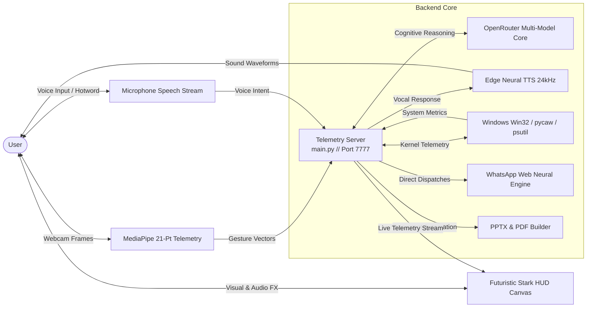

<div align="center">

<!-- Animated Holographic HUD Header -->


<br/><br/>

[](https://python.org)
[](https://opencv.org)
[](https://developers.google.com/mediapipe)
[](https://github.com/rany2/edge-tts)
[](https://microsoft.com/windows)
[](LICENSE)

<br/>

**Intelligent Multi-Modal Desktop AI Assistant with Computer Vision Gesture Telemetry, Real-Time Voice Synthesis, and Autonomous System Automation**

[Explore Architecture](docs/ARCHITECTURE.md) • [10+ Gesture Controls](docs/GESTURE_CONTROLS.md) • [API Reference](docs/API_REFERENCE.md) • [Setup Guide](docs/SETUP_GUIDE.md) • [Live Demo Preview](demo/index.html)

</div>

---

## 🌟 Executive Abstract

Modern desktop computing environments often require manual keyboard and mouse interactions that can hinder seamless multitasking and touchless control. **INFINITY // J.A.R.V.I.S. Mark VII** is an intelligent multi-modal desktop assistant and personal user interface (PUI) integrating conversational artificial intelligence, optical computer vision, and operating-system-level telemetry automation.

The system leverages state-of-the-art Large Language Models (LLMs) via OpenRouter for high-agency reasoning, contextual query resolution, and multi-turn dialogues, combined with real-time speech recognition and text-to-speech (TTS) audio synthesis. An integrated Computer Vision engine built on OpenCV and MediaPipe optical telemetry enables touchless hand gesture controls including master mute freeze, HUD scaling, rotary volume dial, window switching, stealth lock, and air-mouse reticle navigation.

On the backend, an asynchronous Python telemetry server interfacing with Windows APIs (via `ctypes`, `winreg`, `psutil`, `pycaw`, and `screen_brightness_control`) enables direct system management including hardware monitoring, volume/brightness modulation, automated PowerPoint presentation and PDF generation (`reportlab` / `python-pptx`), and zero-latency application indexing. The frontend delivers a futuristic, cybernetic webview HUD with responsive visual feedback, sound cues, and interactive telemetry widgets.

---

## 🔮 Core System Pillars

```
       ┌────────────────────────────────────────────────────────┐
       │                INFINITY // MARK VII PUI                │
       └───────────────────────────┬────────────────────────────┘
                                   │
         ┌─────────────────────────┼─────────────────────────┐
         ▼                         ▼                         ▼
  ╔═══════════════╗         ╔═══════════════╗         ╔═══════════════╗
  ║    OPTICAL    ║         ║   COGNITIVE   ║         ║    WINDOWS    ║
  ║    VISION     ║         ║   AI VOICE    ║         ║   TELEMETRY   ║
  ║  MediaPipe 3D ║         ║   OpenRouter  ║         ║   Win32/pycaw ║
  ║  21-Landmarks ║         ║   Edge TTS    ║         ║  psutil Core  ║
  ╚═══════════════╝         ╚═══════════════╝         ╚═══════════════╝
         │                         │                         │
         └─────────────────────────┼─────────────────────────┘
                                   │
         ┌─────────────────────────┴─────────────────────────┐
         ▼                                                   ▼
  ╔═══════════════════════════╗               ╔═══════════════════════════╗
  ║   AUTONOMOUS WORKFLOWS    ║               ║   STARK HOLOGRAPHIC HUD   ║
  ║  WhatsApp Neural Dispatch ║               ║   Canvas 3D / WebGL / CSS3║
  ║  Auto PPTX & PDF Reports  ║               ║   Audio Viseme Spectrum   ║
  ╚═══════════════════════════╝               ╚═══════════════════════════╝
```

### 1. Optical Hand Gesture Telemetry (Touchless Control)
A dedicated 60 FPS computer vision pipeline analyzing 21 3D hand landmarks per frame. Replaces physical input with natural gestures including palm push freezing, rotary volume tuning, holographic zooming, and air-mouse navigation.

### 2. Cognitive Voice Engine & Multi-Model Reasoning
Powered by OpenRouter LLM orchestration (supporting Gemini 2.0, Claude 3.5 Sonnet, GPT-4o) with persistent hotword wake (`"JARVIS"`), natural conversational tool dispatch, and high-fidelity 24kHz neural speech output.

### 3. Deep Operating System Telemetry
Native Windows integration via `pycaw`, `ctypes`, and `psutil` providing hardware stats (CPU, RAM, GPU, Battery, Temperatures), display brightness control, audio endpoint management, and workstation security lockdown.

### 4. WhatsApp Web Neural Dispatch (1-on-1 Direct Routing)
Hands-free messaging engine engineered with **strict group avoidance**:
- Wakes Edge WhatsApp Web and opens direct messages via the `New Chat` modal to guarantee **zero group disruption**.
- Automated dispatches for daily Scripture reflections, Stoic leadership maxims, friendship check-ins, and scheduled deliveries.

### 5. Autonomous Presentation & Document Engine
Converts notes, voice prompts, and research queries into styled PowerPoint (`.pptx`) decks and print-ready PDF reports (`reportlab` / `python-pptx`) complete with automated layout engines and QR code generation.

### 6. Cybernetic Personal User Interface (PUI)
Stark Industries-inspired holographic HUD rendered in Edge WebView2 with WebGL shaders, reactive audio spectrum equalizers, target tracking reticles, and real-time telemetry overlays.

---

## 📐 Architecture & Telemetry Pipeline



---

## ✋ Optical Gesture Quick Reference

| # | Gesture | Trigger Motion | Action Performed | HUD Feedback |
| :-: | :--- | :--- | :--- | :--- |
| **01** | **Repulsor Palm Freeze** | Flat open palm pushed toward webcam | Mutes master audio, halts media & active speech | Expanding cyan energy ring + laser power-down sound |
| **02** | **Holographic Pinch Zoom** | Thumb + Index pinch & expand/contract | Smooth zoom on browser, PDF, or scales HUD | 3D wireframe bounding box with `MAG: %` gauge |
| **03** | **Rotary Arc Volume Dial** | Index finger traces circular arc in air | Increases/decreases master audio volume | Circular cyan/amber arc dial with numeric volume |
| **04** | **Repulsor Swipe** | Swift horizontal swipe of open palm | Next/previous slide, tab switching (`Ctrl+Tab`) | Motion blur trail with directional arrow telemetry |
| **05** | **Stealth Mode Cross-Fist** | Both hands raised with closed fists crossed | Locks Windows workstation (`LockWorkStation`) | Red lockdown banner: `STEALTH PROTOCOL ACTIVATED` |
| **06** | **Air-Mouse Reticle** | Index pointing raycast; thumb tap click | Fluid mouse cursor movement + Left/Right click | Glowing cyan reticle with screen coordinate readouts |
| **07** | **Two-Finger Scroll** | Index + Middle extended, waved up/down | Smooth vertical page & document scrolling | Dual neon guide tracks with dynamic velocity pulse |
| **08** | **Window Minimize Fist** | Rapidly contract open hand into a fist | Minimizes active foreground window | Holographic collapse animation + vortex chime |
| **09** | **Peace Sign Screenshot** | Index + Middle in a "V" shape | Captures screen and indexes to `screenshots/` | Cyan camera flash with HUD thumbnail preview |
| **10** | **Thumbs Up Confirm** | Fist closed, thumb pointing up | Confirms pending prompt or dispatch | Green holographic checkmark badge + confirm chime |

*For complete kinematic formulas, landmark vectors, and hysteresis thresholds, see [docs/GESTURE_CONTROLS.md](docs/GESTURE_CONTROLS.md).*

---

## ⚡ Voice Commands & Autonomous Workflows

```bash
# Voice Commands Examples
"JARVIS, set volume to 75 percent"
"JARVIS, what is my CPU and memory usage?"
"JARVIS, take a screenshot and analyze the screen"
"JARVIS, lock my workstation"

# Autonomous WhatsApp Dispatches (Strict 1-on-1, Group Avoidance)
"JARVIS, send daily Bible verse with reflection to hx partner"
"JARVIS, send today's Stoic quote to arun kumar"
"JARVIS, send friendship check-in to vedanth"
"JARVIS, schedule a message to mom at 8:30 PM saying I will call you tonight"

# Autonomous Document Generation
"JARVIS, generate a 10-slide presentation on Quantum Computing"
"JARVIS, convert my notes into a summary PDF report"
```

---

## 🚀 Quickstart & Installation

### 1. Prerequisites
- **Windows 10 / 11** (64-bit)
- **Python 3.10+**
- **HD Webcam & Microphone**
- **Microsoft Edge WebView2**

### 2. Setup
```powershell
# Clone the repository
git clone https://github.com/gudimetlasanthosh16-png/infinity.git
cd infinity

# Create and activate virtual environment
python -m venv .venv
.\.venv\Scripts\Activate.ps1

# Install dependencies
pip install -r requirements.txt

# Configure environment variables
copy .env.example .env
```

### 3. Launching J.A.R.V.I.S.
Run the startup script:
```powershell
.\run_jarvis.bat
```
or run directly via Python:
```powershell
python main.py
```

### 4. Interactive HUD Animation Preview
Preview the standalone cybernetic HUD and gesture simulator directly in your browser:
Open [demo/index.html](demo/index.html).

---

## 📂 Repository Structure

```
infinity/
├── assets/
│   ├── infinity_hud_header.svg      # Animated holographic Arc Reactor HUD header
│   └── infinity_badge_animation.svg # Animated telemetry status badge
├── demo/
│   └── index.html                   # Standalone browser HUD animation & simulator
├── docs/
│   ├── ARCHITECTURE.md              # System architecture, threading & IPC specifications
│   ├── GESTURE_CONTROLS.md          # 10+ optical gestures, landmark geometry & triggers
│   ├── API_REFERENCE.md             # Telemetry server REST endpoints & tool schema
│   ├── SETUP_GUIDE.md               # Step-by-step Windows deployment & troubleshooting
│   └── WHATSAPP_DISPATCH.md         # WhatsApp Web Neural Dispatch engine guide
├── gui/
│   ├── index.html                   # Futuristic Stark PUI Webview HUD interface
│   ├── style.css                    # Cybernetic HUD styles, animations & shaders
│   ├── app.js                       # HUD controller, audio visualizer & gesture client
│   └── *.wasm / *.tflite            # MediaPipe WebAssembly & model assets
├── main.py                          # Multi-threaded server, Win32 bridge & CV engine
├── video_generator.py               # Automated video & multimedia synthesizer
├── features59.md                    # Extended cybernetic protocol documentation
├── features.txt                     # Hand gesture specifications & instruction registry
├── requirements.txt                 # Python system dependencies
├── .env.example                     # Environment template (OpenRouter keys, port)
├── .gitignore                       # Clean repository ignore configuration
└── README.md                        # Project dossier & documentation hub
```

---

## 👥 Academic Project Team & Credentials

**Project Title:** J.A.R.V.I.S.: Intelligent Multi-Modal Desktop AI Assistant with Computer Vision Gesture Telemetry, Real-Time Voice Synthesis, and Autonomous System Automation  
**Project Batch:** 21CS15 (Academic Year 2026 – 2027)  
**Project Guide:** K. Kishore Kumar  

| Member Name | University Roll Number | GitHub Profile |
| :--- | :---: | :---: |
| **G. Santhosh Kumar** | `24HP1A0559` | [@gudimetlasanthosh16-png](https://github.com/gudimetlasanthosh16-png) |
| **K. Tejdeep Reddy** | `24HP1A0563` | |
| **Md. Minaj** | `24HP1A0550` | |
| **Christopher Alwin Raj** | `24HP1A0538` | |

---

## 📄 License

This project is licensed under the [MIT License](LICENSE) - see the LICENSE file for details. Built for high-agency human-computer interaction and next-generation desktop computing.
