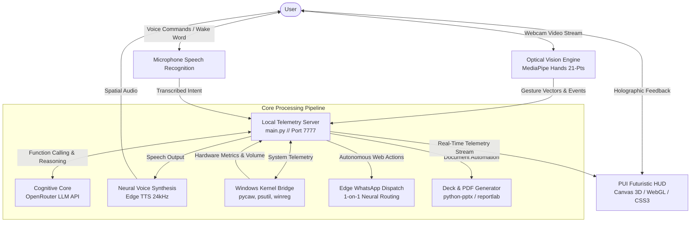

# System Architecture & Technical Specifications

## 1. Architectural Overview

**INFINITY // J.A.R.V.I.S. Mark VII** is built upon a decoupled, asynchronous multi-tier architecture uniting:
1. **Perception Engine**: Real-time Computer Vision via MediaPipe and OpenCV running 60 FPS hand landmark telemetry.
2. **Cognitive Core**: Large Language Model reasoning via OpenRouter API supporting real-time function calling and tool dispatch.
3. **Audio Synthesis & Hotword Subsystem**: Wake-word listener coupled with high-fidelity 24kHz Edge Neural TTS.
4. **Desktop Automation & Operating System Telemetry**: Native Windows Win32 APIs (`ctypes`, `winreg`, `psutil`, `pycaw`, `screen_brightness_control`).
5. **Personal User Interface (PUI)**: Cybernetic HUD rendered via Microsoft Edge WebView2 / Modern Webview running Canvas 3D & WebGL shaders.

---

## 2. Decoupled Threading & Concurrency Model

Because optical landmark detection and natural voice generation must operate without blocking desktop interactions, `main.py` utilizes a dedicated multi-threaded runtime:

| Thread Component | Duty Cycle | Primary Responsibility |
| :--- | :--- | :--- |
| **Telemetry Server Thread** | Continuous (I/O Bound) | Hosts the embedded `ThreadingHTTPServer` on `127.0.0.1:7777`, delivering live JSON telemetry, handling REST actions, and serving HUD assets. |
| **Vision Telemetry Thread** | 60 FPS (CPU/GPU Bound) | Captures webcam frames, computes 21 3D hand landmarks via MediaPipe, calculates Euclidean joint distances, and applies hysteresis filtering to eliminate gesture flicker. |
| **Voice Hotword Daemon** | Continuous (Event Driven) | Listens for the wake word (`"JARVIS"` or `"Infinity"`), executes local speech recognition, and routes transcribed prompts to the Cognitive Core. |
| **Audio Playback Thread** | On-Demand (Async) | Streams synthesized neural speech through `pygame` or `pydub` while dispatching spectrum visualizer packets to the HUD. |
| **Automation Queue Worker** | Priority Queue | Executes scheduled dispatches (e.g. timed WhatsApp messages or deferred file exports) without blocking the main event loop. |

---

## 3. Optical Gesture Pipeline

The Optical Gesture Engine analyzes 21 landmarks per detected hand in normalized screen coordinates:

$$\text{Distance}(P_1, P_2) = \sqrt{(x_2 - x_1)^2 + (y_2 - y_1)^2 + (z_2 - z_1)^2}$$

### Gesture Detection State Machine
1. **Acquisition**: MediaPipe isolates hand bounds and computes 3D coordinates.
2. **Kinematic Analysis**: The engine checks finger extension states (comparing fingertip $y$-coordinates against PIP and MCP joints).
3. **Threshold Gate**: Evaluates whether distance vectors meet predefined activation bounds (e.g. pinch distance $< 0.05$).
4. **Hysteresis Smoothing**: Requires sustained gesture confirmation for $\ge N$ consecutive frames ($N=3$ for instant freeze, $N=5$ for rotary dial) to prevent unintended triggers.
5. **Dispatch**: Sends event payload to Windows Core (e.g., `WM_APPCOMMAND` for audio mute).

---

## 4. Windows Telemetry & Automation Bridge

The bridge communicates directly with Windows subsystem DLLs:
- **`user32.dll` & `kernel32.dll`**: Foreground window targeting, virtual keystrokes, and lock station calls (`LockWorkStation`).
- **`CoreAudio` via `pycaw`**: Endpoint volume control, peak audio monitoring, and master session mute.
- **`screen_brightness_control`**: WMI/DDC-CI display backlight regulation.
- **`psutil`**: Live CPU load, RAM allocation, GPU telemetry, and process tree surveillance.
