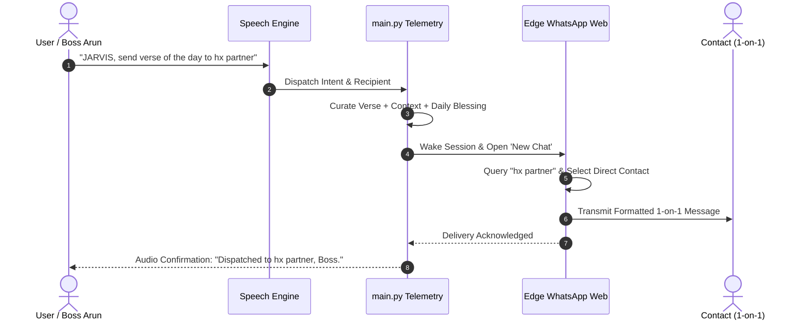

# WhatsApp Web Neural Dispatch Engine

The **WhatsApp Web Neural Dispatch Engine** provides hands-free, autonomous direct messaging designed to deliver personal dispatches, scheduled briefings, and documents without disturbing group conversations.

---

## 1. Core Operating Principles

1. **Strict 1-on-1 Routing (Zero Group Disturbance)**:
   - When searching for contacts, the engine uses the `New Chat` / Direct Message modal rather than searching in the active conversation list.
   - This architectural choice ensures that group chats sharing similar names or keywords are **never selected or interrupted**.
2. **Multi-Word Fuzzy Contact Matching**:
   - Matches colloquial speech names (e.g. `"hx partner"`, `"bharghav frd"`, `"mom"`) against local contact aliases and WhatsApp contact cards.
3. **Archived Contact Traversal**:
   - If a conversation was previously archived, the engine unhides or addresses the contact directly via contact book resolution.
4. **Autonomous In-Memory Priority Scheduling**:
   - Allows users to schedule delayed deliveries (e.g. `"JARVIS, send message at 8:30 PM"`).
   - A background timer wakes Edge WhatsApp Web at the exact timestamp, transmits the payload, and returns to standby.

---

## 2. Supported Autonomous Dispatches

### Daily Spiritual & Wisdom Briefings
- **Scripture Reflection**: Fetches a curated Bible verse, historical theological insight, and a daily blessing.
- **Stoic Leadership Maxim**: Delivers reflections from Marcus Aurelius, Seneca, or Epictetus tailored for high-focus executive routines.
- **Friendship & Team Check-In**: Composes warm, personalized check-in messages for friends or colleagues.

### Document & Presentation Forwarding
- Automatically converts notes or reports into PDFs or PowerPoint slide decks (`python-pptx` / `reportlab`).
- Directly attaches the generated files to the recipient's direct chat window.

---

## 3. Workflow Flowchart

